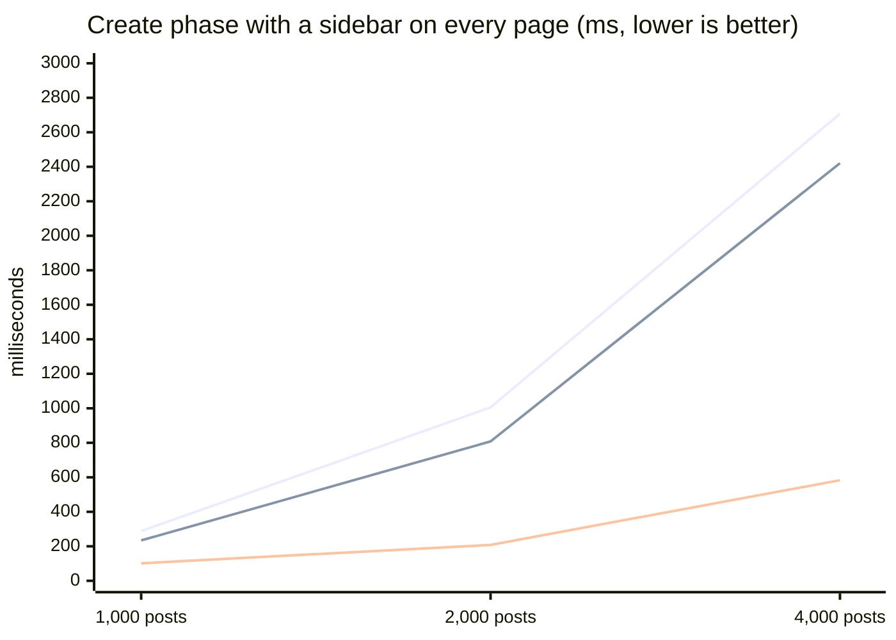
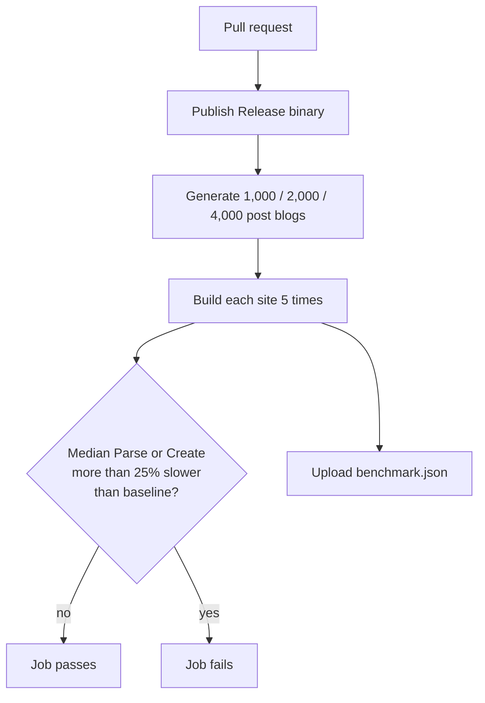

A static site generator should disappear into your workflow. You save a file, the site is rebuilt, and you never think
about it. That works until your site grows, and then one innocent line in a theme starts costing you seconds on every
build.

Fanstatic is now part of the MASS4 family, and the MASS4 sites are our first customers. So for Fanstatic 7.2 we went
looking for everything that makes a build slow *as a site grows*, measured it on real sites, and fixed it.

* [The result at a glance](#the-result-at-a-glance)
* [Why builds go quadratic](#why-builds-go-quadratic)
* [What changed](#what-changed)
* [Benchmarks on real MASS4 sites](#benchmarks-on-real-mass4-sites)
* [Benchmarks on synthetic blogs](#benchmarks-on-synthetic-blogs)
* [For theme authors: stop sorting on every page](#for-theme-authors-stop-sorting-on-every-page)
* [Find your own slow template](#find-your-own-slow-template)
* [A guardrail so it stays fast](#a-guardrail-so-it-stays-fast)
* [Good to know](#good-to-know)
* [What's next](#whats-next)

## The result at a glance

| | Fanstatic 7.1.1 | Fanstatic 7.2.0 | Change |
|---|---:|---:|---:|
| Turian site, full build (486 files, 1,839 outputs) | 841 ms | **647 ms** | **-23%** |
| Turian site, Create phase | 753 ms | **558 ms** | **-26%** |
| 4,000-post blog with a "recent posts" sidebar on every page, Create phase | 2,707 ms | **583 ms** | **-78%** |
| 4,000-post blog, Parse phase | 182 ms | **78 ms** | **-57%** |

Small sites were already instant, and they stay instant: the Fanstatic documentation site and the MASS4 site build in the same time as before, give or take a few milliseconds. The gains grow with the size of your site.

## Why builds go quadratic

Most of a build is linear: read a file, render a page, write it. The cost explodes when every page does work proportional to *all* pages. A typical example is a "recent posts" sidebar:

```liquid

```

Every page re-sorts the whole site. With N pages that is N sorts of N items: double the posts and the work goes up by more than four.


Parse and Generate Pages grow roughly linearly. Create is where themes live, so it is where the curve bends, and
where this release spends most of its effort.

## What changed

| Area | What we did | Who benefits |
|---|---|---|
| Page collections | `site.Pages` and `RegularPages` are built once, after pages are registered, instead of re-scanned on every access | Every theme |
| Derived values | `Plain`, `WordCount`, `TagsReference` and `Taxonomies` are computed once per page | Themes that show word counts, reading time or tags |
| Page content | A page's `Content` is rendered once, however many lists, feeds and home pages include it | Lists, RSS, home pages |
| Sorted views | New cached views: `RegularPagesByDate`, `ByLastMod`, `ByWeight`, `ByTitle` (and the `Pages…` equivalents) | Themes that sort per page |
| Template cache | Compiled templates are looked up by file path instead of by hashing the template body | Every theme |
| Parsing | Markdown files in a folder are read and parsed in parallel, then linked in a fixed, sorted order | Large content folders |
| Observability | `fanstatic build --template-metrics` reports calls, time and cache hits per template | Theme authors |
| Guardrail | A benchmark target with a regression gate runs in CI | Everyone, in the future |

Two details matter for correctness:

* **Cycles are reported, not deadlocked.** If page A's content reads page B's content and B reads A's, the build now stops with a clear error instead of hanging.
* **Ordering is deterministic.** Pages with equal weight are ordered by source path, so two builds of the same input give the same output. This can change the order of equal-weight lists compared with 7.1.1, for example home-page cards or RSS items.

## Benchmarks on real MASS4 sites

We built three real sites with the same compiler flags, once with the 7.1.1 source and once with 7.2.0. Each number is the median of 5 builds after a warm-up, in milliseconds, as printed in Fanstatic's own build report.

| Site | Markdown files | Outputs | Phase | 7.1.1 | 7.2.0 | Change |
|---|---:|---:|---|---:|---:|---:|
| **Turian** | 486 | 1,839 | Parse | 45 | 40 | -11% |
| | | | Create | 753 | **558** | **-26%** |
| | | | Total | 841 | **647** | **-23%** |
| **Fanstatic docs** | 85 | 247 | Create | 101 | 105 | within noise |
| | | | Total | 154 | 162 | within noise |
| **MASS4** | 13 | 57 | Create | 46 | 46 | none |
| | | | Total | 90 | 96 | within noise |

The pattern is what you would expect from the changes above: sites with hundreds of pages and shared layouts win, and sites with a few dozen pages have nothing left to save.

Turian is the interesting one. Its pages share a base layout and many list pages, which is exactly where cached content and cached collections pay off. And there is more to win: see [Find your own slow template](#find-your-own-slow-template).

## Benchmarks on synthetic blogs

To see how builds scale, we generated blogs with 1,000, 2,000 and 4,000 posts, three tags per post, and a "recent posts" sidebar with word counts on **every** post page. Create phase, median of 5 builds, in milliseconds:

| Posts | 7.1.1, `sort` in the theme | 7.2.0, same theme | 7.2.0, cached view | Change with cached view |
|---:|---:|---:|---:|---:|
| 1,000 | 288 | 234 | **101** | -65% |
| 2,000 | 1,005 | 808 | **208** | -79% |
| 4,000 | 2,707 | 2,421 | **583** | -78% |



The three lines are, from top to bottom: 7.1.1, 7.2.0 with an unchanged theme, and 7.2.0 with a theme that uses the cached view. Two things stand out:

* An unchanged theme gets 10 to 20% faster. The sort itself is still there, so the curve is still steep.
* A theme that uses the new cached view cuts the cost by roughly three to five times and flattens the curve a lot.

For comparison, the same blogs **without** a sidebar:

| Posts | Parse 7.1.1 | Parse 7.2.0 | Create 7.1.1 | Create 7.2.0 | Total 7.1.1 | Total 7.2.0 |
|---:|---:|---:|---:|---:|---:|---:|
| 1,000 | 54 | **30** | 59 | 57 | 163 | **144** |
| 2,000 | 95 | **47** | 71 | 74 | 225 | **185** |
| 4,000 | 182 | **78** | 99 | 99 | 352 | **274** |

Without a quadratic pattern in the theme, Create was already flat. Parallel parsing makes the Parse phase 1.8 to 2.3 times faster.

## For theme authors: stop sorting on every page

The new views are ordered **ascending**, are computed once, and are shared by every page:

| If your theme sorts `site.RegularPages` by | Use |
|---|---|
| `'Date'` | `site.RegularPagesByDate` |
| `'Lastmod'` | `site.RegularPagesByLastMod` |
| `'Weight'` | `site.RegularPagesByWeight` |
| `'Title'` | `site.RegularPagesByTitle` |

The same four views exist on a page: `page.RegularPagesByDate`, `page.PagesByDate`, and so on.

For a "newest first" list, use the `reversed` and `limit` modifiers of `for`:

```liquid
{# before: sorts and reverses the whole site on every page #}

...

{# after #}

  <a href="{{ post.RelPermalink }}">{{ post.Title }}</a>

```

Prefer `for ... reversed limit: N` over `| reverse`. The `reverse` filter still copies the whole list on every page. The views need Fanstatic 7.2 or later; an older binary will not know them and renders an empty list.

## Find your own slow template

Add `--template-metrics` to a build and Fanstatic prints one row per template, sorted by total time:

```sh
fanstatic build --template-metrics
```

This is the report for the Turian site:

| Template | Calls | Total | Max | Cache hits |
|---|---:|---:|---:|---:|
| `_default/baseof.html` | 917 | 10,943 ms | 129 ms | 917 |
| `docs/single.html` | 152 | 2,834 ms | 74 ms | 152 |
| `_default/single.html` | 299 | 164 ms | 13 ms | 299 |
| `blog/single.html` | 29 | 86 ms | 10 ms | 29 |
| *(inline templates)* | 4,780 | 69 ms | 6 ms | 4,658 |

Times are inclusive and summed over all threads, so they add up to more than the wall-clock build time. Partials rendered with `` count towards the template that calls them. A page's `Content` is charged to the first template that reads it. For Turian, the report points straight at the documentation layout, which still sorts and scans all pages for every documentation page. That is a ready-made to-do list for its theme.

## A guardrail so it stays fast

Performance work rots when nobody is watching. The repository now has a `Benchmark` target that generates synthetic blogs with 1,000, 2,000 and 4,000 posts, builds each one with the freshly published binary, and fails if the Parse or Create phase becomes more than 25% slower than the stored baseline.



The first version of this gate is deliberately conservative: its baseline was recorded on a developer machine, so the CI job is not a required check yet. We will switch to a baseline recorded on the CI runner before we rely on it.

## Good to know

* **How we measured.** .NET SDK 10.0.112, one machine, medians of 5 builds after a warm-up, using Fanstatic's own Parse, Create and Total figures. 7.1.1 and 7.2.0 were built from source with identical publish flags. Your hardware and theme will give different absolute numbers; the shape of the curves is the point.
* **7.2.0 contains more than speed.** It also ships configurable taxonomies, so pages that show tags and categories can differ from 7.1.1. Read the [taxonomy guide](/docs/content/taxonomy) when you upgrade.
* **Equal-weight ordering is now stable.** Lists that relied on an accidental order may come out differently once; they will not change again from build to build.

## What's next

Cached views remove the sort, but Liquid still wraps a list into its own array type every time a template reads it. For a 4,000-post site that is the remaining 583 ms in the table above, against 99 ms with no sidebar. Caching that wrapper is the next step, followed by incremental rebuilds in `serve`, so that editing one page does not rebuild the site.

Try it, run `--template-metrics` on your own site, and tell us what you find.

[Download It Now](https://github.com/MASS4ORG/Fanstatic/releases/tag/v7.2.0)

[View Changelog](https://github.com/MASS4ORG/Fanstatic/blob/main/CHANGELOG.md)
